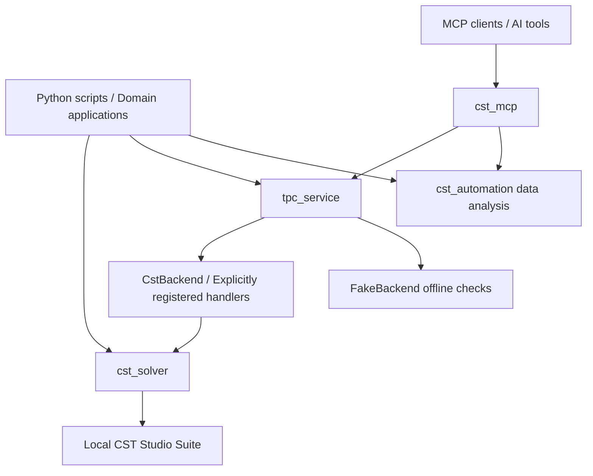

# cst-automation

**Connect CST Studio Suite modeling, simulation, result analysis, and task management with Python.**

[简体中文](README.md) | **English**

[](pyproject.toml)
[](docs/guides/mcp-usage.md)
[](LICENSE)

`cst-automation` is a general-purpose Python library for electromagnetic simulation workflows. It brings together CST project operations, parametric modeling, solver configuration, result reading, offline data analysis, and traceable task execution. MCP integration and repository-local Codex skills help scripts and AI tools reuse those capabilities.

Use the standalone curve utilities on their own, or use the library as a foundation for a domain application that connects project preparation to result reporting.

> Current version: `0.1.0`. The core package supports Python 3.9+; the MCP extra requires Python 3.10+. Real CST operations require a local CST Studio Suite installation, an available license, and an interpreter compatible with its Python extension. Offline analysis and the fake backend can run without CST.

## Contents

- [Use cases](#use-cases)
- [Features](#features)
- [Architecture](#architecture)
- [Quick start](#quick-start)
- [Examples](#examples)
- [MCP and AI workflows](#mcp-and-ai-workflows)
- [Repository layout](#repository-layout)
- [Validation and boundaries](#validation-and-boundaries)
- [Documentation](#documentation)
- [Development and contributions](#development-and-contributions)
- [FAQ](#faq)

## Use cases

- **Parametric modeling:** turn repeated geometry, material, port, and boundary configuration into reusable Python operations.
- **Simulation management:** submit solve jobs for existing CST projects and inspect status, logs, result summaries, and artifacts.
- **Batch result analysis:** extract threshold bands from S-parameter curves, locate resonances, and compare resonance positions across designs.
- **Domain applications:** register your own modeling or study handlers while reusing the common task lifecycle.
- **AI-assisted operation:** discover capabilities, register projects, inspect jobs, and analyze data through MCP, with repository skills guiding the workflow.

## Features

| Area | Capabilities | Entry point |
| --- | --- | --- |
| Projects and parameters | Open, save, close, attach to sessions, manage units and parameters | `cst_solver.setup` |
| Geometry | Primitives, curves, Boolean operations, transforms, coordinate systems, picks, and face operations | `cst_solver.modeling` |
| Simulation configuration | Materials, ports, sources, monitors, boundaries, mesh, and solver interfaces | `cst_solver.material` / `simulation` / `mesh` |
| Postprocessing | Result reading, far fields, plot control, and result export interfaces | `cst_solver.Result` / `postprocessing` |
| Curve analysis | Contiguous threshold bands, local resonances, matching, and criteria | `cst_automation.curves` |
| Grouped S2P text | Read grouped data, filter frequencies, and select parameter groups | `cst_automation.s2p` |
| Task execution | A serial worker queue, persisted state, logs, artifacts, and handler extensions | `tpc_service.RunService` |
| Environment diagnostics | Installation discovery, configuration sources, Python ABI, and SDK import checks | `python -m cst_solver doctor --json` |
| MCP integration | Projects, solving, job inspection, CSV analysis, reporting, and tool registration | `cst_mcp` |
| Codex skills | Guidance for modeling, simulation, results, and diagnostics | [Skills index](skills/README.md) |

These entries describe the available code interfaces. Compatibility with a particular CST version, solver, or real project must be verified in the target environment.

## Architecture



The four import names serve distinct purposes: `cst_solver` handles CST operations, `cst_automation` supplies independent data utilities, `tpc_service` manages jobs, and `cst_mcp` exposes MCP tools. The library does not depend on TPC or em-enclosure; domain packages register their extensions explicitly.

Ordinary imports and offline parsing do not start CST. Its SDK is loaded when a real CST operation needs it.

## Quick start

### 1. Get the source and create an isolated environment

The commands below use Windows PowerShell. Python 3.11 is recommended for the complete development and MCP setup.

```powershell
git clone https://github.com/Ding-zhenke/cst-automation.git
cd cst-automation
python -m venv .venv
.\.venv\Scripts\Activate.ps1
python -m pip install --upgrade pip
```

### 2. Choose an installation

| Purpose | Run from the repository root |
| --- | --- |
| Core library and offline analysis | `python -m pip install .` |
| Core library and MCP server | `python -m pip install ".[mcp]"` |
| Optional plotting dependencies | `python -m pip install ".[plot]"` |
| Development, tests, and MCP | `python -m pip install -e ".[dev,mcp]"` |

NumPy is the core dependency. The MCP extra uses `mcp>=1.29,<2`, matching the SDK 1.x API used by the current implementation.

### 3. Diagnose the CST environment

For offline analysis, continue directly to the examples. Before real CST operations, run:

```powershell
python -m cst_solver doctor --json
```

The `cst` Python module ships with CST Studio Suite. Do not use `pip install cst` as an installation step. If discovery fails, follow the [environment guide](docs/guides/cst_environment.md) to configure `CST_INSTALL_PATH`, `CST_PYTHON_LIB`, and `CST_MATERIAL_LIB`, and match the interpreter ABI to the CST extension. See [installation](docs/INSTALLATION.md) for details.

## Examples

### Offline analysis: threshold bands and resonances

This example needs no CST installation. Frequencies are in GHz and curve values are in dB.

```python
from cst_automation.curves import contiguous_bands, find_resonances

freqs_ghz = [1.0, 1.1, 1.2, 1.3, 1.4]
s11_db = [-8.0, -16.0, -20.0, -12.0, -5.0]

bands = contiguous_bands(freqs_ghz, s11_db, threshold_db=-10.0)
resonances = find_resonances(freqs_ghz, s11_db, kind="min")
print("Bands:", bands)
print("Resonances:", resonances)
```

Bands use contiguous sampled points; resonances use three-point local extrema without interpolation. Use `read_s2p_groups(filepath)` for grouped S2P text. Its supported format is described in the [public API contract](docs/PUBLIC_API.md).

### CST project: open, save, and release a session

Replace the path with an existing local project. This example connects to real CST and requires the environment checks above.

```python
from cst_solver import setup

app = setup(r"C:\simulations\example.cst")
try:
    # Call the required parameter, modeling, or simulation methods here.
    app.save()
finally:
    app.close()
```

Before writing geometry, generate and review a preview using the actual parameters. Rebuild in stages, read CST messages, and check artifacts afterward. See the [Python guide](docs/guides/python-usage.md).

### Offline task service: register your own operation

This example uses `FakeBackend` to demonstrate handlers and the job queue. It performs no real modeling or solving.

```python
from pathlib import Path
from tempfile import TemporaryDirectory

from tpc_service import RunService
from tpc_service.backends.base import ok_result
from tpc_service.backends.fake import FakeBackend

Path("./work").mkdir(exist_ok=True)
workspace = TemporaryDirectory(dir="./work")
project = Path(workspace.name) / "placeholder.cst"
project.write_text("fake-only placeholder", encoding="utf-8")
service = RunService(str(Path(workspace.name) / "jobs"), backend=FakeBackend())

def offline_build(*, project, params, job, backend):
    return ok_result(
        saved=True,
        log=[f"accepted {job['job_id']}"],
        result_summary={"mode": "offline-example"},
    )

try:
    service.register_handler("build", offline_build)
    job = service.submit("build", project_path=str(project))
    print(service.wait(job["job_id"], timeout=10))
finally:
    service.shutdown()
    workspace.cleanup()
```

The real backend supports solving existing projects; domain-specific `build` and `study` operations require explicit handlers. Each service has a serial worker. A wait timeout returns the current state snapshot. On restart, leftover queued/running jobs become interrupted and are not automatically retried. See the [service contract](docs/PUBLIC_API.md) for fields and constraints.

## MCP and AI workflows

After installing the MCP extra, use a client with stdio support to launch:

```powershell
python -m cst_mcp
```

In the client configuration, point command to the isolated environment's Python executable and set args to `["-m", "cst_mcp"]`. The host client launches this protocol service; the exact configuration format depends on that client.

| Environment variable | Purpose |
| --- | --- |
| `CST_AUTOMATION_WORKDIR` | Set a writable job and artifact directory |
| `CST_AUTOMATION_BACKEND=fake` | Debug offline tool workflows with the simulated backend |

Write tools go through `RunService`. Standard output is reserved for MCP protocol frames; diagnostics go to standard error or artifacts. Register domain tools explicitly with `cst_mcp.register_tool(...)`. The server does not install or rewrite global MCP client settings. See the [MCP guide](docs/guides/mcp-usage.md).

When using Codex in this repository, read [AGENTS.md](AGENTS.md) and the [skills index](skills/README.md), then select the modeling, simulation, results, or diagnostics skill relevant to the task.

## Repository layout

```text
cst-automation/
├── cst_automation/    # Standalone curve and grouped S2P utilities
├── cst_solver/        # CST projects, modeling, simulation, results, diagnostics
├── tpc_service/       # General task service and backends
├── cst_mcp/           # MCP adapter and tool registration
├── skills/            # Four repository-local Codex skills
├── docs/              # Installation, usage, contracts, migration, validation
├── tests/             # Repository tests; packages also contain their own tests
├── .github/workflows/ # Windows CI tests and builds
└── pyproject.toml     # Package metadata, dependencies, test configuration
```

## Validation and boundaries

- Regular tests use fakes, stubs, and offline files without requiring CST. Interactive Windows desktop tests run separately.
- FakeBackend produces synthetic data. Passing offline tests does not establish real geometry rebuild, result readback, or solver success.
- Installation discovery, ABI matching, SDK imports, project readback, and real solving are separate checks. A successful doctor report does not establish solver acceptance.
- Validation records for this extracted release do not report real CST geometry rebuild, result readback, or solver acceptance. Consult [VALIDATION.md](docs/VALIDATION.md) for the actual evidence.
- The grouped S2P reader does not promise support for every Touchstone format or complex network matrices.
- During `0.x`, cross-package protocol changes are recorded in minor versions. See [PUBLIC_API.md](docs/PUBLIC_API.md) for contracts and compatibility policy.

## Documentation

| Document | What it covers |
| --- | --- |
| [Installation](docs/INSTALLATION.md) | Environment, dependencies, development setup |
| [CST environment](docs/guides/cst_environment.md) | Discovery, paths, ABI compatibility |
| [Python usage](docs/guides/python-usage.md) | Data analysis, sessions, service entry points |
| [MCP usage](docs/guides/mcp-usage.md) | stdio startup, environment variables, extensions |
| [Troubleshooting](docs/guides/troubleshooting.md) | Environment, execution, diagnostic issues |
| [Public API](docs/PUBLIC_API.md) | Handlers, states, errors, version contracts |
| [Migration map](docs/MIGRATION_MAP.md) | Module origins and migration scope |
| [Validation records](docs/VALIDATION.md) | Observed checks and unverified areas |
| [Repository skills](skills/README.md) | Modeling, simulation, results, diagnostics |
| [Contributing](CONTRIBUTING.md) | Development rules and verification |

This English README provides the same onboarding coverage as the Chinese homepage. The detailed documents linked above retain their existing languages, primarily Chinese.

## Development and contributions

Use [Issues](https://github.com/Ding-zhenke/cst-automation/issues) for bug reports and feature requests, or submit a pull request. Useful reports include Python/CST versions, a minimal reproduction, the actual error, and diagnostic output with sensitive details removed.

Install development dependencies in an isolated environment and run:

```powershell
python -m pip install -e ".[dev,mcp]"
python -m pytest -o addopts='' -m "not gui" -q
python -m build --wheel --sdist
```

Real desktop UI Automation tests require an interactive Windows session and explicit execution:

```powershell
python -m pytest -o addopts='' -m gui -q cst_solver/tests/test_dialog_windows.py
```

Update the public contract before changing cross-package protocols, keep domain logic in extensions, and record offline checks, project readback, and real solving separately. See [CONTRIBUTING.md](CONTRIBUTING.md).

## FAQ

**Can I use this without CST?** Yes: curve analysis, grouped text parsing, and offline job workflows with an explicitly selected `FakeBackend` are available. Real project operations require CST.

**Why keep the name `tpc_service`?** It preserves Python import compatibility. The module is a general service and does not require TPC; callers register domain functionality.

**Can MCP run on Python 3.9?** The core supports Python 3.9, while the MCP extra requires Python 3.10+. Python 3.11 is recommended for the full development setup.

**Are specific antenna, topology, or enclosure designs included?** The library supplies common infrastructure. External applications implement domain-specific builds and studies through handlers.

## License

Released under the [MIT License](LICENSE). Use of CST Studio Suite remains subject to its own license terms.
