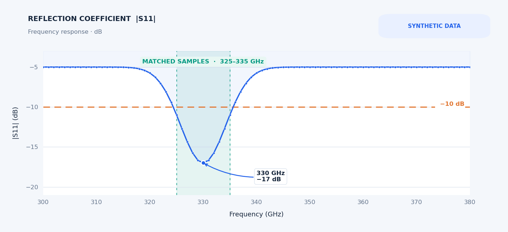
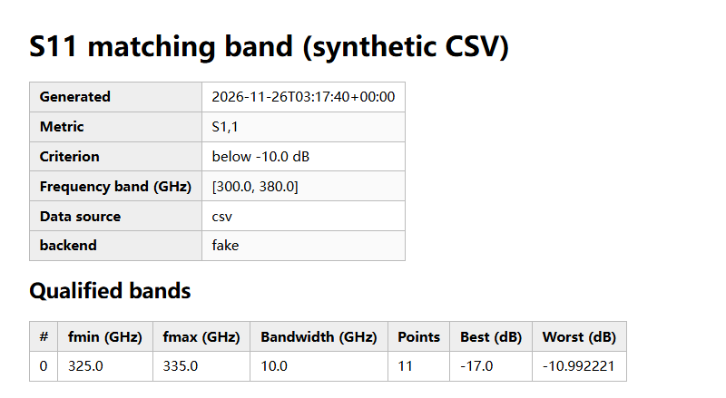
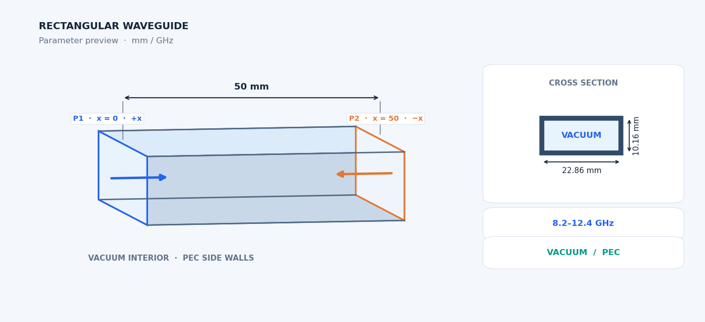

# cst-automation

**Use AI to build CST models, run electromagnetic simulations and analyze S-parameters. In Keysight ADS, ask it to draw a circuit and run harmonic balance.**

[简体中文](README.md) · **English**　|　[Try the CSV example](#start-with-a-csv) · [Set up Codex](#set-up-codex) · [Browse the skills](skills/README.md)

With a CSV on hand, you can ask “Over which frequencies is my input well matched?” For a new waveguide, you can ask to see the port locations and directions before Codex writes the model to CST. The examples below pair prompts you can paste into a chat with the plots, projects and data files to expect.

## Start with a CSV

Open this repository in Codex with the Python package and plotting dependencies installed. The [setup instructions](#set-up-codex) cover a fresh checkout. This example runs on the synthetic data included in the repository and requires only Python.

> Read `fake_sparams_job.csv` in the repository root. Use `freq_GHz` for the x-axis. Find every consecutive set of samples where `S1,1` ≤ −10 dB. Report each band's start and end frequencies, bandwidth and minimum. Use Python to plot the original samples and threshold, and shade the qualifying bands. Export an HTML report and a point-by-point CSV, and give me the file paths.



With 1 GHz between samples, 11 points meet the criterion from **325 to 335 GHz**. The difference between those endpoints gives a **10 GHz bandwidth**. The minimum is **−17 dB at 330 GHz**. To analyze your own file, give Codex the frequency unit, the column to analyze and the threshold. [Sample CSV](fake_sparams_job.csv)

<details>
<summary>See the HTML report generated from this CSV</summary>



With MCP configured, Codex can call `analyze_s_parameters` to find bands and local extrema. The `export_report` tool writes the HTML and CSV files to the server's working directory. Compare the *Qualified bands* table with the shaded region in the plot, or inspect individual samples in the CSV.

</details>

<details>
<summary>Reproduce the result in Python</summary>

Run this code from the repository root. It prints the band edges in GHz, followed by the frequency and value of the minimum.

```python
from cst_automation.curves import contiguous_bands
from cst_mcp.analysis import read_series_csv

samples = read_series_csv("fake_sparams_job.csv")
bands = contiguous_bands(samples["freqs"], samples["columns"]["S1,1"], threshold_db=-10)
for band in bands:
    print(band["fmin_ghz"], band["fmax_ghz"], band["best_freq_ghz"], band["best_db"])
# 325.0 335.0 330.0 -17.0
```

</details>

## Give Codex an engineering task

Specify the input, how far to proceed and what you want to check. “Show me the ports first,” “Run this project once” and “Read the saved results” give Codex three different jobs.

### Review the ports, then build a waveguide

> I need a straight, vacuum-filled rectangular waveguide with a 22.86 × 10.16 mm inner cross section, extending 50 mm along x. Use PEC for all four side walls and one single-mode waveguide port at each end. The operating range is 8.2–12.4 GHz. First draw a dimensioned preview. Mark each port face and add arrows showing excitation into the guide. Wait for my review.



Check the orientation of the wide and narrow sides. P1 should point into the guide along +x from `x = 0`, and P2 along −x from `x = 50 mm`. This preview lets you review the dimensions and port placement before the project is built. [Waveguide dimensions and coordinates](docs/REAL_CST_ACCEPTANCE.md)

**After reviewing the drawing, you can continue in the same chat.**

> Build and save the CST project from the preview we reviewed. Read the two port locations and directions back from CST. Send me those values and the project path, then stop after modeling.

> Run the reviewed project once. When it finishes, give me the Run ID, the CST solver log and the S11 and S21 magnitude plots. If the run stalls, check the original job and tell me which step it reached.

When you return the next day, give Codex the session reference and job ID so it can retrieve the same project's job status, logs and results. [Modeling](skills/cst-modeling/SKILL.md) · [EM simulation](skills/cst-simulation/SKILL.md) · [Sessions and job status](docs/guides/conversation_sessions.md)

### Hand a completed CST sweep to a circuit designer

> My two-port microstrip project is at `<project path>.cst` and its sweep results are saved. The ports are ordered input, output. The original reference impedance is 50 Ω and frequencies are in GHz. Use the saved runs only. For each positive Run ID, export the full complex S-matrix for that trace width to a new directory at `<export directory>`. Give me a table mapping widths to files and check the number of samples and the frequency range in each file.

Codex can use `Result.export_touchstone_sweep` to produce one `run_<id>.s2p` per run and a `manifest.json`. In a recorded CST export, Run IDs 1, 2 and 3 corresponded to trace widths of 1.7, 1.9 and 2.1 mm. Each file contained all four complex S-parameters at 1,001 frequencies from 1 to 6 GHz. Each file's hash matched the manifest. [Export interface](skills/cst-results/references/exports-and-history.md) · [Validation record](docs/VALIDATION.md)

### Measure the difference tone of an ADS mixer

> Use the repository's ADS mixer example to build an editable diode mixer in a new workspace at `<workspace path>`. Set the LO to 1 GHz and the RF input to 1.1 GHz. Run harmonic balance (HB) and generate the report. Find the 100 MHz difference tone in the resulting dataset and tell me its actual frequency, amplitude and unit. Give me the schematic cell name and paths to the dataset and spectrum CSV.

The example builds the `Mixer_HB` schematic using the ADS Python API. The two input frequencies predict the difference tone at 100 MHz. Its amplitude comes from the output dataset, `simulation/Mixer_HB.ds`. Running the script with `--with-report` also produces a spectrum CSV and a Chinese-language report. This example requires a licensed local ADS installation. [Mixer example script](skills/keysight-ads-simulation/scripts/mixer_smoke_test.py) · [ADS environment setup](skills/keysight-ads-simulation/references/environment-and-compatibility.md)

## Set up Codex

**Work from the source repository.** In Windows PowerShell, use Python 3.10 or later for the commands below. They create a virtual environment and install the plotting and Model Context Protocol (MCP) dependencies. The core Python library also supports Python 3.9.

```powershell
git clone https://github.com/Ding-zhenke/cst-automation.git
cd cst-automation
python -m venv .venv
.\.venv\Scripts\python.exe -m pip install -e ".[mcp,plot]"
```

Open the cloned directory in Codex and start a chat with this prompt.

> Read `skills/README.md`, choose the skill that fits my task and use the repository's `.venv`. Start with the CSV example in the README. Send me the plot and report when the analysis is complete.

**Work from another project.** Install the repository's skills as a Codex plugin to use the same modeling, simulation and analysis instructions in other projects. The skills guide Codex through the task, and the separately installed Python package supplies the CST interfaces. Native CST operations require a licensed installation and an interpreter compatible with its SDK. ADS tasks use the Keysight Python environment for your ADS installation. [Build and install the plugin](docs/guides/codex-plugin.md) · [Installation guide](docs/INSTALLATION.md) · [CST environment diagnostics](docs/guides/cst_environment.md)

<details>
<summary>Configure MCP for job queries, curve analysis and report export</summary>

Add the following to a trusted project's `.codex/config.toml`. Replace every occurrence of `C:\repos\cst-automation` with the absolute path to your checkout. The `--enable-sessions` flag enables persistent CST sessions, and `--enable-circuit` enables CST Design Studio tools.

```toml
[mcp_servers.cst_automation]
command = 'C:\repos\cst-automation\.venv\Scripts\python.exe'
cwd = 'C:\repos\cst-automation'
args = ['-m', 'cst_mcp', '--enable-sessions', '--session-root', 'C:\repos\cst-automation\work\sessions', '--enable-circuit', '--workdir', 'C:\repos\cst-automation\work\mcp']
```

Run `codex mcp get cst_automation --json` from the project directory to inspect the configuration. In a new chat, ask “Call `get_capabilities` and tell me the active backend and working directory” to verify that Codex can reach the server. [MCP guide](docs/guides/mcp-usage.md)

</details>

## Find a workflow

| Task | What you can get | Where to start |
| --- | --- | --- |
| Build, mesh or solve a CST 3D model | A parametric project, port settings read back from CST, native solver logs and curves by Run ID | [Modeling](skills/cst-modeling/SKILL.md) · [Mesh and frequency](skills/cst-mesh-frequency/SKILL.md) · [EM simulation](skills/cst-simulation/SKILL.md) |
| Sweep parameters and archive results | Sweep settings, a Touchstone file for each case and a parameter manifest | [Parameter studies](skills/cst-parameter-study/SKILL.md) · [Results](skills/cst-results/SKILL.md) |
| Couple a field model to a CST Design Studio circuit | A schematic connected to the EM block, circuit task settings and static S-parameters or transient results | [Schematics](skills/cst-schematic/SKILL.md) · [Circuit tasks](skills/cst-circuit/SKILL.md) |
| Design circuits and layouts in ADS | Editable schematics, DC/SP/HB datasets, Data Displays and physical layouts | [Schematics](skills/keysight-ads-schematic/SKILL.md) · [Simulation](skills/keysight-ads-simulation/SKILL.md) · [Results](skills/keysight-ads-results/SKILL.md) · [Layout](skills/keysight-ads-layout/SKILL.md) |
| Develop a Python workflow | Call curve analysis and CST APIs directly, register job handlers and expose tools over MCP | [Python guide](docs/guides/python-usage.md) · [Public API](docs/PUBLIC_API.md) |

To build these workflows into your own program, use `cst_solver` for CST operations and `cst_automation` for offline data analysis. The `tpc_service` package queues jobs and persists their status, and `cst_mcp` exposes tools to AI clients.

For field–circuit co-simulation, the repository includes a native CST run report and a time-step convergence study. [Co-simulation run report](docs/CIRCUIT_LIVE_REPORT.md) · [Time-step study](docs/CIRCUIT_TIMESTEP_REPORT.md)

Consult the validation record for other tested cases, the troubleshooting guide for run failures and the contribution guide for development and testing. [Validation record](docs/VALIDATION.md) · [Troubleshooting](docs/guides/troubleshooting.md) · [Contributing](CONTRIBUTING.md) · [MIT license](LICENSE)
