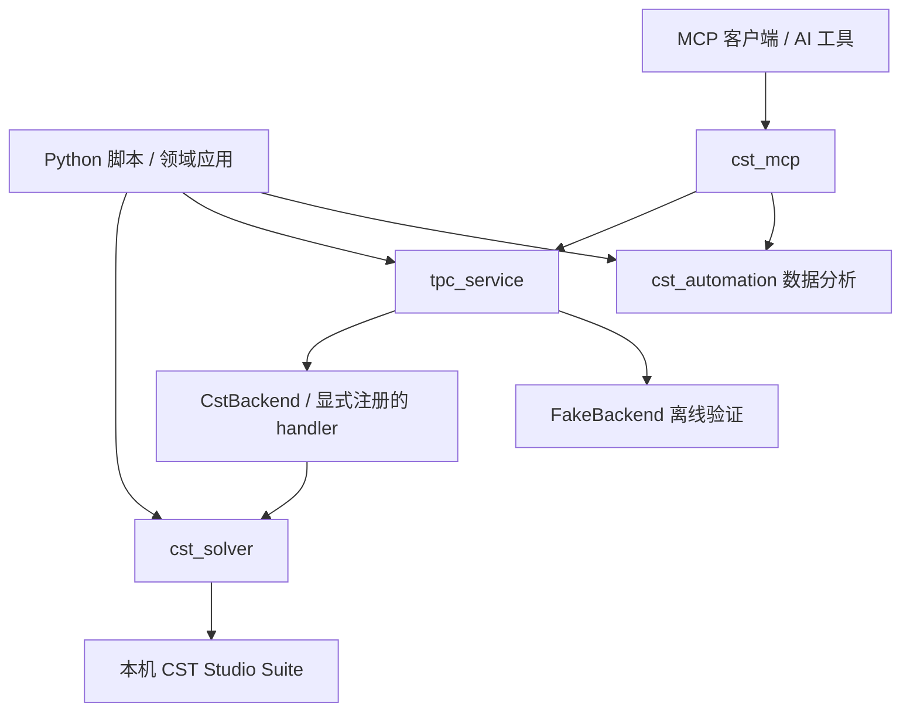

# cst-automation

**用 Python 串联 CST Studio Suite 建模、仿真、结果分析与任务管理。**

**简体中文** | [English](README.en.md)

[](pyproject.toml)
[](docs/guides/mcp-usage.md)
[](LICENSE)

`cst-automation` 是面向电磁仿真工作流的通用 Python 工具库。它将 CST 工程操作、参数化建模、求解配置、结果读取、离线数据分析和可追踪的任务执行组织在同一个项目中，也提供 MCP 接口与仓库内 Codex skills，便于脚本和 AI 工具复用这些能力。

你可以只使用其中的曲线分析工具，也可以把它作为领域建模程序的底层依赖，逐步搭建从工程准备到结果报告的自动化流程。

> 当前版本为 `0.1.0`。核心包支持 Python 3.9+；MCP extra 需要 Python 3.10+。真实 CST 操作需要本机 CST Studio Suite、可用许可证以及与 CST Python 扩展兼容的解释器。离线分析与 fake backend 可在没有 CST 的环境使用。

## 导航

- [适用场景](#适用场景)
- [主要功能](#主要功能)
- [项目架构](#项目架构)
- [快速开始](#快速开始)
- [使用示例](#使用示例)
- [MCP 与 AI 工作流](#mcp-与-ai-工作流)
- [项目结构](#项目结构)
- [验证范围与使用边界](#验证范围与使用边界)
- [文档导航](#文档导航)
- [开发与贡献](#开发与贡献)
- [常见问题](#常见问题)

## 适用场景

- **参数化建模**：把重复的几何、材料、端口和边界配置整理成可复用的 Python 操作。
- **仿真流程管理**：对已有 CST 工程提交求解任务，读取状态、日志、结果摘要和产物。
- **批量结果分析**：根据 S 参数曲线提取阈值频带、寻找谐振点、比较不同设计的谐振位置。
- **领域工具开发**：通过显式注册 handler 连接自己的建模或研究逻辑，复用通用任务生命周期。
- **AI 辅助操作**：通过 MCP 工具发现能力、登记工程、检查任务和分析数据，并结合仓库 skills 约束操作流程。

## 主要功能

| 能力 | 提供的内容 | 主要入口 |
| --- | --- | --- |
| 工程与参数 | 工程打开、保存、关闭、会话连接、单位和参数管理 | `cst_solver.setup` |
| 几何建模 | 基本实体、曲线、布尔运算、变换、坐标系、选取与面操作 | `cst_solver.modeling` |
| 仿真配置 | 材料、端口、激励、监视器、边界、网格与求解器配置接口 | `cst_solver.material` / `simulation` / `mesh` |
| 后处理 | 结果读取、远场、绘图控制及结果导出接口 | `cst_solver.Result` / `postprocessing` |
| 曲线分析 | 连续合格频带、局部谐振点、谐振匹配与判据 | `cst_automation.curves` |
| 分组 S2P 文本 | 分组数据读取、频率筛选、参数条件筛选 | `cst_automation.s2p` |
| 任务运行 | 单 worker 串行队列、状态持久化、日志、产物和 handler 扩展 | `tpc_service.RunService` |
| 环境诊断 | CST 安装发现、配置来源、Python ABI 与 SDK 导入检查 | `python -m cst_solver doctor --json` |
| MCP 集成 | 工程、求解、任务查询、CSV 分析、报告与工具扩展 | `cst_mcp` |
| Codex skills | 建模、仿真、结果与故障诊断操作指引 | [skills 索引](skills/README.md) |

四个 skill 也可打包为一个按需选择 skill 的 Codex 插件，原有 skill 文件保持不变。构建和使用方式见 [Codex 插件指南](docs/guides/codex-plugin.md)。

上述功能描述的是代码提供的接口范围；具体 CST 版本、求解器与真实工程的可用性仍需在目标环境验证。

## 项目架构



四个 Python 导入名各司其职：`cst_solver` 面向 CST 操作，`cst_automation` 提供独立数据工具，`tpc_service` 管理任务，`cst_mcp` 暴露 MCP 接口。通用库不依赖 TPC 或 em-enclosure；领域包向本库注册扩展。

普通导入和离线解析不会启动 CST。CST SDK 在执行真实 CST 操作时按需加载。

## 快速开始

### 1. 下载源码并创建独立环境

以下命令以 Windows PowerShell 为例；建议使用 Python 3.11 体验完整开发与 MCP 功能。

```powershell
git clone https://github.com/Ding-zhenke/cst-automation.git
cd cst-automation
python -m venv .venv
.\.venv\Scripts\Activate.ps1
python -m pip install --upgrade pip
```

### 2. 选择安装方式

| 用途 | 在仓库根目录运行 |
| --- | --- |
| 核心库与离线数据分析 | `python -m pip install .` |
| 核心库与 MCP 服务 | `python -m pip install ".[mcp]"` |
| 可选绘图依赖 | `python -m pip install ".[plot]"` |
| 开发、测试与 MCP | `python -m pip install -e ".[dev,mcp]"` |

核心依赖为 NumPy。MCP extra 使用 `mcp>=1.29,<2`，对应当前适配的 SDK 1.x API。

### 3. 检查本机 CST 环境

如果只做离线分析，可直接进入下方示例。真实 CST 操作前运行：

```powershell
python -m cst_solver doctor --json
```

CST 的 `cst` 模块随 CST Studio Suite 提供，请勿将 `pip install cst` 作为安装步骤。自动发现失败时，按[环境配置指南](docs/guides/cst_environment.md)设置 `CST_INSTALL_PATH`、`CST_PYTHON_LIB`、`CST_MATERIAL_LIB`，并确认 Python ABI 与 CST 扩展匹配。完整步骤见[安装文档](docs/INSTALLATION.md)。

发行包不预设任何电脑的安装路径。未配置时自动发现常见目录；非标准安装目录通过环境变量或用户 JSON 指定。`doctor --json` 会对路径缺失或已知 ABI 不匹配返回非零退出码；加上 `--probe` 才执行 SDK 导入检查。

## 使用示例

### 离线分析：提取合格频带与谐振点

此示例不需要安装 CST，输入频率单位为 GHz、幅度为 dB。

```python
from cst_automation.curves import contiguous_bands, find_resonances

freqs_ghz = [1.0, 1.1, 1.2, 1.3, 1.4]
s11_db = [-8.0, -16.0, -20.0, -12.0, -5.0]

bands = contiguous_bands(freqs_ghz, s11_db, threshold_db=-10.0)
resonances = find_resonances(freqs_ghz, s11_db, kind="min")
print("Bands:", bands)
print("Resonances:", resonances)
```

频带按连续采样点划分，谐振点按三点局部极值判定，不进行插值。分组 S2P 文本可使用 `read_s2p_groups(filepath)` 读取；该函数的格式范围见[公共接口](docs/PUBLIC_API.md)。

### CST 工程：打开、保存与释放会话

将路径替换为已有的本机工程。执行此示例会连接真实 CST，需要先完成环境检查。

```python
from cst_solver import setup

app = setup(r"C:\simulations\example.cst")
try:
    # 在此调用所需的参数、建模或仿真配置方法。
    app.save()
finally:
    app.close()
```

几何写入前应先按真实参数生成预览并审阅；随后分阶段重建、读取 CST 消息并检查产物。更多用法见[Python 使用指南](docs/guides/python-usage.md)。

### 离线任务服务：注册自己的操作

下面使用 `FakeBackend` 演示 handler 与任务队列，不进行真实建模或求解。

```python
from pathlib import Path
from tempfile import TemporaryDirectory

from tpc_service import RunService
from tpc_service.backends.base import ok_result
from tpc_service.backends.fake import FakeBackend

Path("./work").mkdir(exist_ok=True)
workspace = TemporaryDirectory(dir="./work")
project = Path(workspace.name) / "placeholder.cst"
project.write_text("fake-only placeholder", encoding="utf-8")
service = RunService(str(Path(workspace.name) / "jobs"), backend=FakeBackend())

def offline_build(*, project, params, job, backend):
    return ok_result(
        saved=True,
        log=[f"accepted {job['job_id']}"],
        result_summary={"mode": "offline-example"},
    )

try:
    service.register_handler("build", offline_build)
    job = service.submit("build", project_path=str(project))
    print(service.wait(job["job_id"], timeout=10))
finally:
    service.shutdown()
    workspace.cleanup()
```

真实 backend 对已有工程提供求解；领域 `build` / `study` 由调用方显式注册。单个服务的 worker 串行运行任务，超时返回当前状态快照；重启会将遗留 queued/running 任务标记为 interrupted，不自动重跑。详细字段与约束见[任务服务协议](docs/PUBLIC_API.md)。

## MCP 与 AI 工作流

安装 MCP extra 后，由支持 stdio 的 MCP 客户端启动：

```powershell
python -m cst_mcp
```

客户端配置时，将 command 指向独立环境中的 Python，将 args 设为 `["-m", "cst_mcp"]`。这是一项由宿主客户端启动的协议服务，具体配置格式以客户端为准。

| 环境变量 | 用途 |
| --- | --- |
| `CST_AUTOMATION_WORKDIR` | 设置可写的任务与产物目录 |
| `CST_AUTOMATION_BACKEND=fake` | 使用离线模拟 backend 调试工具流程 |

写操作通过 `RunService` 执行；标准输出专供 MCP 协议，诊断写入标准错误或产物。领域工具通过 `cst_mcp.register_tool(...)` 显式注册。服务不会安装或改写用户全局 MCP 配置。详见[MCP 使用指南](docs/guides/mcp-usage.md)。

使用 Codex 处理本仓库任务时，先阅读 [AGENTS.md](AGENTS.md) 和 [skills 索引](skills/README.md)，再按任务选择建模、仿真、结果或诊断 skill。

## 项目结构

```text
cst-automation/
├── cst_automation/    # 独立曲线与分组 S2P 数据工具
├── cst_solver/        # CST 工程、建模、仿真、结果与诊断
├── tpc_service/       # 通用任务服务及 backend
├── cst_mcp/           # MCP 适配与工具注册
├── skills/            # 四类仓库内 Codex skills
├── docs/              # 安装、使用、接口、迁移与验证说明
├── tests/             # 仓库级测试；各包还包含自己的 tests
├── .github/workflows/ # Windows CI 测试与构建
└── pyproject.toml     # 包元数据、依赖与测试配置
```

## 验证范围与使用边界

- 常规测试使用 fake、stub 和离线文件，不要求本机 CST；交互式 Windows 桌面测试单独运行。
- FakeBackend 返回合成数据。离线测试通过不代表真实几何重建、结果读回或 solver 求解通过。
- 安装发现、ABI 匹配、SDK 导入、工程读回和真实求解分别检查；doctor 通过不能替代求解验收。
- 当前拆分版本的验证记录未报告真实 CST 几何重建、结果读回或求解验收；请以 [VALIDATION.md](docs/VALIDATION.md) 的具体证据为准。
- 分组 S2P 读取接口不承诺覆盖所有 Touchstone 格式或复数网络矩阵。
- `0.x` 跨包协议变更按次要版本记录；公共协议与兼容策略见 [PUBLIC_API.md](docs/PUBLIC_API.md)。

## 文档导航

| 文档 | 内容 |
| --- | --- |
| [安装与配置](docs/INSTALLATION.md) | 环境、依赖与本地开发安装 |
| [CST 环境](docs/guides/cst_environment.md) | 安装发现、路径与 ABI |
| [Python 使用](docs/guides/python-usage.md) | 数据分析、会话与服务入口 |
| [MCP 使用](docs/guides/mcp-usage.md) | stdio 启动、环境变量与扩展 |
| [故障定位](docs/guides/troubleshooting.md) | 环境、运行与诊断问题 |
| [公共 API](docs/PUBLIC_API.md) | handler、状态、错误与版本协议 |
| [迁移映射](docs/MIGRATION_MAP.md) | 模块来源及迁移范围 |
| [验证记录](docs/VALIDATION.md) | 已执行检查与尚未验证的范围 |
| [仓库 skills](skills/README.md) | 建模、仿真、结果与诊断规范 |
| [贡献指南](CONTRIBUTING.md) | 开发约定与检查流程 |

英文版主页提供同等的入门内容；上述深入文档保留各自现有语言。

## 开发与贡献

欢迎通过 [Issues](https://github.com/Ding-zhenke/cst-automation/issues) 反馈问题、提出功能建议，或提交 Pull Request。问题报告建议包含 Python/CST 版本、最小复现、实际错误和脱敏后的诊断输出。

在独立环境安装开发依赖后运行：

```powershell
python -m pip install -e ".[dev,mcp]"
python -m pytest -o addopts='' -m "not gui" -q
python -m build --wheel --sdist
```

真实桌面 UI Automation 测试需要交互式 Windows 会话，显式执行：

```powershell
python -m pytest -o addopts='' -m gui -q cst_solver/tests/test_dialog_windows.py
```

请在修改跨包协议前同步公共接口文档，保持领域逻辑通过扩展接入，并分别记录离线检查、工程读回与真实求解证据。完整约定见 [CONTRIBUTING.md](CONTRIBUTING.md)。

## 常见问题

**没有 CST 也能使用吗？** 可以使用曲线分析、分组文本解析和显式指定 `FakeBackend` 的离线任务流程。真实工程操作仍需要 CST。

**为什么保留 `tpc_service` 名称？** 为保持 Python 导入兼容。该模块是通用服务，不要求安装 TPC；领域功能由调用方注册。

**能直接用 Python 3.9 运行 MCP 吗？** 核心包支持 Python 3.9，MCP extra 需要 Python 3.10+。完整开发环境建议使用 Python 3.11。

**是否内置具体天线、拓扑或腔体设计？** 通用库提供底层能力；具体领域的构建和研究任务由外部应用通过 handler 实现。

## 许可证

本项目采用 [MIT License](LICENSE)。CST Studio Suite 的使用仍受其自身许可证约束。
