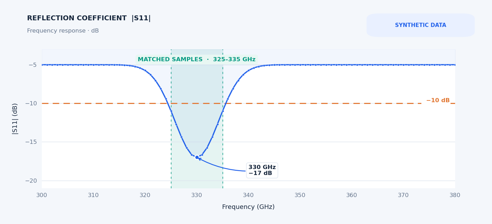
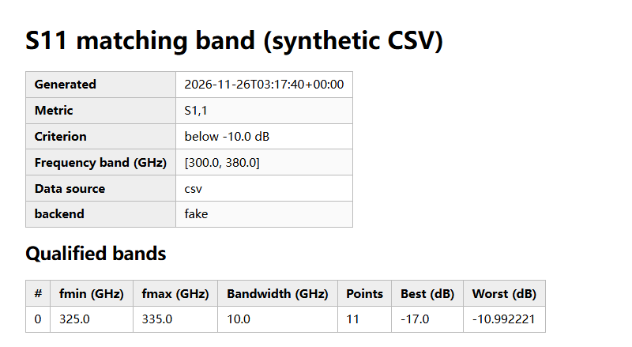
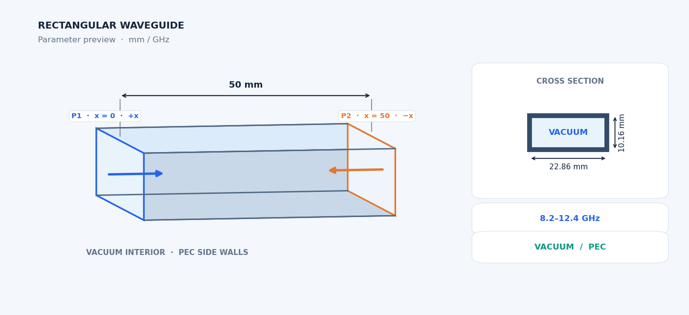

# cst-automation

**让 AI 帮你画出 CST 模型、运行电磁仿真、读出 S 参数，也能在 Keysight ADS 中搭电路、做谐波平衡分析。**

**简体中文** · [English](README.en.md)　|　[动手试一个例子](#用一份-csv-开始) · [接入 Codex](#接入-codex) · [全部技能](skills/README.md)

如果你有一份 S 参数 CSV，可以直接问「哪些频率满足匹配要求？」。如果你要建一个波导，可以先让 AI 画出两个端口的位置和方向，审过图再写入 CST。下面的例子给出了可以直接发给 Codex 的指令，以及应该收到的图、工程和数据文件。

## 用一份 CSV 开始

在 Codex 中打开本仓库，使用已安装核心包和绘图依赖的 Python 环境。第一次使用可先按下方的[安装步骤](#接入-codex)准备。这一例只需仓库自带的合成样本，可以在没有 CST 或 ADS 的电脑上完成。

> 读取仓库根目录的 `fake_sparams_job.csv`。用 `freq_GHz` 作横轴，找出 `S1,1` ≤ −10 dB 的所有连续采样区间，列出起止频率、带宽和最低点。用 Python 画出原始采样和阈值，在图上标出合格区间。再导出 HTML 报告和逐点 CSV，把文件路径给我。



这份样本以 1 GHz 为步长。**325–335 GHz** 之间共有 11 个合格点，按两端之差计算带宽为 **10 GHz**。最低点在 **330 GHz，为 −17 dB**。换成自己的文件时，给出频率单位、列名和判据即可。[查看示例 CSV](fake_sparams_job.csv)

<details>
<summary>查看这个例子实际导出的 HTML 报告截图</summary>



接入 MCP 后，Codex 可以用 `analyze_s_parameters` 算频带和局部极值，用 `export_report` 将 HTML 和 CSV 写入服务工作目录。报告中的 *Qualified bands* 表可与图上的阴影区间核对，CSV 保留逐点数值。

</details>

<details>
<summary>用 Python 复核同一个结果</summary>

在仓库根目录运行下面的代码。输出依次是合格区间的起点、终点、最低点频率和最低值。

```python
from cst_automation.curves import contiguous_bands
from cst_mcp.analysis import read_series_csv

samples = read_series_csv("fake_sparams_job.csv")
bands = contiguous_bands(samples["freqs"], samples["columns"]["S1,1"], threshold_db=-10)
for band in bands:
    print(band["fmin_ghz"], band["fmax_ghz"], band["best_freq_ghz"], band["best_db"])
# 325.0 335.0 330.0 -17.0
```

</details>

## 让 AI 参与建模和仿真

对一个实际工程，说清楚 **输入在哪里、这次做到哪一步、用什么核对结果**。例如「先给我看端口图」「现在可以运行一次」「只读已保存的结果」会让 Codex 选择不同的操作。下面是三个常见任务。

### 先看端口怎么放，再建波导

> 我想建一个真空矩形直波导，内截面 22.86 × 10.16 mm，沿 x 方向长 50 mm，四侧为 PEC 壁。两端各设一个单模波导端口，工作频率 8.2–12.4 GHz。先给我尺寸图，标出每个端口所在的面和指向波导内部的激励箭头，等我审图。



审图时先看截面的宽、高是否对应你想要的方向，再看 P1 是否从 `x = 0` 指向 +x、P2 是否从 `x = 50 mm` 指向 −x。图中展示的是写入工程前可交付的参数预览。[波导尺寸与坐标表](docs/REAL_CST_ACCEPTANCE.md)

**审图后可以继续说**

> 按刚才的预览创建并保存 CST 工程，读回两端口的位置和方向，把工程路径和读回值给我。这一步做到建模为止。

> 现在可以运行这份已审阅的工程。完成后给我本次 Run ID、原生求解日志和 S11、S21 幅频曲线。如果中途停下来，沿用原任务查状态，告诉我停在哪一步。

隔天继续时，把会话引用和 job ID 发给 Codex，就可以查回同一工程的任务状态、日志和结果。[建模技能](skills/cst-modeling/SKILL.md) · [求解技能](skills/cst-simulation/SKILL.md) · [会话与任务状态](docs/guides/conversation_sessions.md)

### 把已有 CST 扫参结果交给电路设计者

> 我的两端口微带线工程在 `<工程路径>.cst`，结果已保存，端口顺序是输入、输出，原始参考阻抗为 50 Ω，频率单位 GHz。只读已有运行，按正 Run ID 把每个线宽的完整复数 S 矩阵导出到新目录 `<导出目录>`。给我参数和文件的对照表，检查每个文件的频点数和频率范围。

Codex 可以通过 `Result.export_touchstone_sweep` 交付每个工况的 `run_<id>.s2p` 和 `manifest.json`。在仓库的微带线实机验证中，同一工程的 1.7、1.9、2.1 mm 三种线宽分别对应 Run 1、2、3。每个文件都含 1–6 GHz 的 1001 个采样点和四条复数 S 参数，文件哈希与清单逐一匹配。[导出接口](skills/cst-results/references/exports-and-history.md) · [实机验证记录](docs/VALIDATION.md)

### 用 ADS 验证双音混频器

> 用仓库的 ADS 混频器示例，在新目录 `<工作区路径>` 搭一个可编辑的二极管混频器。LO 设为 1 GHz，RF 设为 1.1 GHz，运行谐波平衡（HB）并生成报告。请从结果数据集找到 100 MHz 差频分量，列出实际频率、幅值和单位，给我原理图所在的 cell、数据集和频谱 CSV。

这个例子通过 ADS 自带的 Python API 搭建 `Mixer_HB` 原理图。1.1 GHz − 1 GHz 给出预期差频，实际幅值从求解生成的 `simulation/Mixer_HB.ds` 中提取。示例脚本的 `--with-report` 选项还会生成频谱 CSV 和中文报告。运行需要本机 ADS 及相应许可证。[混频器示例脚本](skills/keysight-ads-simulation/scripts/mixer_smoke_test.py) · [ADS 运行环境](skills/keysight-ads-simulation/references/environment-and-compatibility.md)

## 接入 Codex

**在源码仓库内使用。** 在 Windows PowerShell 中克隆仓库、创建虚拟环境并安装依赖，然后用 Codex 打开这个目录。Python 核心库支持 3.9+。下面的命令请使用 **Python 3.10 或更高版本**，它会同时安装绘图与 MCP 依赖，适合从上面的 CSV 例子开始。

```powershell
git clone https://github.com/Ding-zhenke/cst-automation.git
cd cst-automation
python -m venv .venv
.\.venv\Scripts\python.exe -m pip install -e ".[mcp,plot]"
```

在 Codex 的第一个对话中输入这段话即可开始。

> 先读 `skills/README.md`，按我的任务选技能，使用仓库的 `.venv`。先从 README 的 CSV 例子开始，算出结果后把图和报告发给我。

**在自己的工程目录里使用。** 将仓库技能安装成 Codex 插件后，可以从其他项目调用同一套建模、仿真和结果读取指引。插件指导 Codex 选择操作，Python 运行库提供具体接口。真实 CST 操作还需要与本机 CST SDK 匹配的解释器和许可证，ADS 操作使用对应安装的 Keysight Python 环境。[插件构建与安装](docs/guides/codex-plugin.md) · [安装指南](docs/INSTALLATION.md) · [CST 环境诊断](docs/guides/cst_environment.md)

<details>
<summary>给 Codex 配置 MCP 工具，查询任务、分析曲线和导出报告</summary>

在受信任项目的 `.codex/config.toml` 中添加下面的配置，把所有 `C:\repos\cst-automation` 替换为实际的仓库绝对路径。`--enable-sessions` 开启持久 CST 会话，`--enable-circuit` 开启 CST Design Studio 电路工具。

```toml
[mcp_servers.cst_automation]
command = 'C:\repos\cst-automation\.venv\Scripts\python.exe'
cwd = 'C:\repos\cst-automation'
args = ['-m', 'cst_mcp', '--enable-sessions', '--session-root', 'C:\repos\cst-automation\work\sessions', '--enable-circuit', '--workdir', 'C:\repos\cst-automation\work\mcp']
```

从该项目目录运行 `codex mcp get cst_automation --json` 查看配置。在新对话里问「调用 `get_capabilities`，告诉我当前后端和工作目录」，即可检查 Codex 与服务的实际连接。[MCP 使用指南](docs/guides/mcp-usage.md)

</details>

## 按任务找入口

| 你手里的任务 | 可以交付什么 | 从这里开始 |
| --- | --- | --- |
| CST 三维建模、网格、单次仿真 | 参数化工程、端口读回、原生日志、按 Run ID 读取的曲线 | [建模](skills/cst-modeling/SKILL.md) · [网格与频率](skills/cst-mesh-frequency/SKILL.md) · [EM 求解](skills/cst-simulation/SKILL.md) |
| 扫参和结果归档 | 扫描设置、每个工况的 Touchstone 文件、参数清单 | [参数研究](skills/cst-parameter-study/SKILL.md) · [结果读取](skills/cst-results/SKILL.md) |
| CST Design Studio 场路联合 | 连接 EM 块的原理图、电路任务设置、静态 S 参数或瞬态结果 | [原理图](skills/cst-schematic/SKILL.md) · [电路任务](skills/cst-circuit/SKILL.md) |
| ADS 电路与版图 | 可编辑原理图、DC/SP/HB 数据集、原生数据显示页面、物理版图 | [原理图](skills/keysight-ads-schematic/SKILL.md) · [仿真](skills/keysight-ads-simulation/SKILL.md) · [结果](skills/keysight-ads-results/SKILL.md) · [版图](skills/keysight-ads-layout/SKILL.md) |
| 开发自己的 Python 流程 | 独立调用曲线分析和 CST API，注册任务处理函数，通过 MCP 暴露工具 | [Python 用法](docs/guides/python-usage.md) · [公共接口](docs/PUBLIC_API.md) |

如果你想把相同流程封装进自己的程序，`cst_solver` 提供 CST 接口，`cst_automation` 提供离线数据分析，`tpc_service` 负责排队与保存任务状态，`cst_mcp` 提供 AI 工具服务。

仓库保留了[场路联合实机记录](docs/CIRCUIT_LIVE_REPORT.md)和[时间步复核](docs/CIRCUIT_TIMESTEP_REPORT.md)。查找其他实测项目或排查运行问题，可从[验证记录](docs/VALIDATION.md)和[故障定位](docs/guides/troubleshooting.md)进入。开发与测试流程见[贡献指南](CONTRIBUTING.md)。本仓库采用 [MIT 许可证](LICENSE)。
