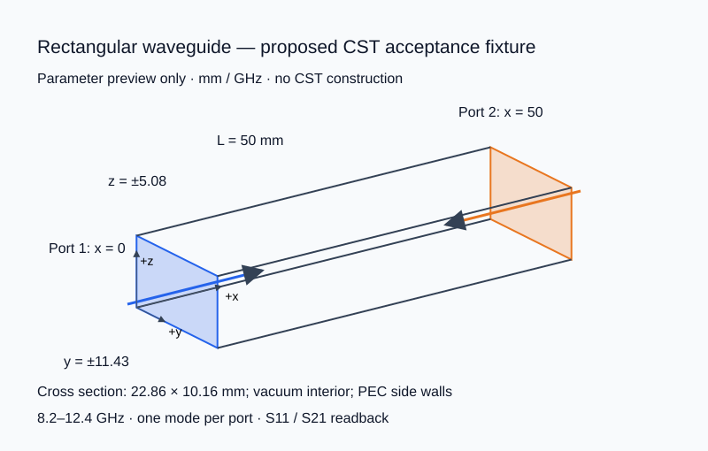

# 真机验收预览（待审阅）

此页是后续真机验收的具体方案，不是 CST 执行记录。按 `AGENTS.md` 和 [cst-modeling](../skills/cst-modeling/SKILL.md) 的要求，先审阅下图及参数，再创建几何。本轮只生成参数预览，没有创建或修改 CST 工程。

## 独立测试工程

创建仓库 `work/real-cst-acceptance/` 下的新工程，不使用或覆盖用户工程。建议采用空气矩形直波导，避免将复杂器件的物理性能混入 API 验收。

| 参数 | 预览值 |
|---|---|
| 单位 | mm、GHz |
| 内部区域 | 真空，x ∈ [0, 50]，y ∈ [-11.43, 11.43]，z ∈ [-5.08, 5.08] |
| 横截面 | 22.86 × 10.16 mm |
| 侧壁 | y/z 四侧电边界，表示理想导电波导壁 |
| 端口 1 | x = 0，整个横截面，orientation = xmin，向 +x 激励 |
| 端口 2 | x = 50，整个横截面，orientation = xmax，向 -x 激励 |
| 端口模态 | 每端口 1 个模态，核对 TE10 场型 |
| 频率 | 8.2–12.4 GHz |
| 求解器候选 | 时域求解器，六面体网格；具体网格和精度设置在启动前记录并确认 |
| 结果目标 | S1,1、S2,1，频率单位 GHz，幅度 20·log10(abs(S)) |

SVG 是上述边界尺寸的参数投影，端口箭头表示进入器件的方向；它不是 CST 几何 readback。封闭波导不用于远场导出验收，远场仍需另一个已审阅的辐射工程。

## 分阶段证据

1. 环境：保存安装发现、配置来源、解释器 ABI 与 `doctor --json --probe` 的原始 JSON。导入成功不能替代许可或求解验证。
2. 几何：审阅通过后按内部区域、边界、端口三个依赖阶段执行；每阶段 rebuild，读实际消息，记录实体数量、尺寸、端口方向和工程路径。失败后先检查真实弹窗标题、正文、按钮及进程归属。
3. 求解：使用已审阅并保存的工程；在启动前记录具体求解器、网格、精度、端口和输出设置。通过 `run_checked` 或通用服务执行，保留 run token、run ID、原始求解状态及保存确认。
4. 结果：从已保存工程显式指定 run ID，记录实际树路径，读取并导出 S 参数；缺少结果时保留失败，不回退到旧 run 或空曲线。
5. 单独安排：真实交互式 UIA 测试、辐射工程远场导出，以及 TPC/em-enclosure 的真实跨包调用。离线测试和此预览均不能提升这些项目的验收等级。

运行中取消接口保持未开放状态；只有完成独立真机停止行为核验后再讨论开放。
